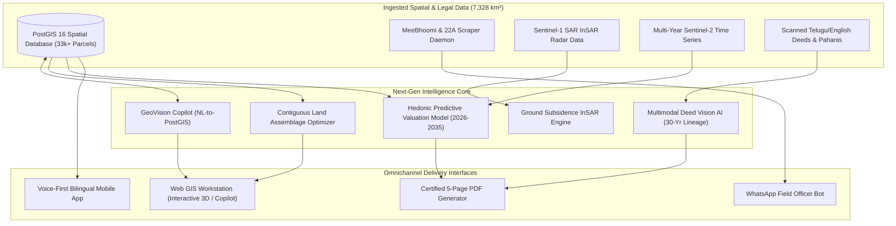

# 🚀 GeoDueDiligence: Next-Generation Features & Product Roadmap (2026–2027)

**Autonomous Land Intelligence & Spatial Due Diligence Platform**  
*Target Region: Visakhapatnam Metropolitan Region Development Authority (VMRDA 2041 — 7,328 km²)*  
*Document Version: 1.0.0 | Status: Approved Architecture Specification*

---

## 📌 Executive Summary

Building upon our production foundations—**100% regional VMRDA coverage (7,328 km²)**, PostGIS spatial migration, sub-second vector tile streaming (MVT & PMTiles), live MeeBhoomi scraper daemon, and institutional 5-page PDF reporting—this roadmap details the high-impact commercial, geospatial, and omnichannel features planned for the next development milestones.

These features are engineered specifically to accelerate institutional adoption by **commercial banks (SBI, HDFC, ICICI)**, **housing finance companies (LIC HFL, PNB Housing)**, **real estate developers (CREDAI AP)**, and **infrastructure investment trusts (InvITs)**.

---

## 🏛️ Tier 1: Commercial, Valuation & Legal Intelligence (High B2B Revenue)

### 1. AP SRO Guidance Value (Circle Rate) & Stamp Duty Engine
* **Business Objective:** Provide immediate financial transparency on statutory land transaction costs, assess under-invoicing tax audit risks, and locate the competent registration office.
* **Key Capabilities:**
  * **SRO Guidance Rate Database:** Automated lookup of government unit values (per Sq. Yard and per Acre) across all Sub-Registrar Offices in VMRDA jurisdiction (Anandapuram, Bheemunipatnam, Pendurthi, Gajuwaka, Anakapalli, Vizianagaram).
  * **Market vs. Guidance Valuation Gap Index:** Flags high capital-gains and black-money tax exposure when market transaction value exceeds the SRO guidance rate by $>2\times$.
  * **Statutory Stamp Duty & Registration Fee Calculator:** Computes the full Andhra Pradesh registration fee breakdown under the AP Registration Act:
    $$\text{Total Registration Cost} = 5.0\%\text{ (Stamp Duty)} + 1.5\%\text{ (Transfer Duty)} + 1.0\%\text{ (Registration Fee)} = 7.5\%$$
  * **Competent SRO Locator:** Identifies the exact territorial Sub-Registrar Office where the sale deed must be registered.
* **API Endpoint:** `POST /api/v1/valuation/guidance-value`
* **Deliverable in PDF:** SRO Guidance Valuation Card & Statutory Stamp Duty Assessment Table on Page 3.

---

### 2. AP RERA Project Registry & Judicial Litigation Screening
* **Business Objective:** Mitigate developer project default risks, unauthorized marketing sanctions, and property ownership disputes in civil courts.
* **Key Capabilities:**
  * **AP RERA Registry Cross-Referencing:** Verifies whether a layout or apartment project has an authentic, unexpired AP RERA registration number (e.g., `P02240...`). Flags unapproved marketing attracting Section 59 RERA penalties.
  * **Civil Court & High Court Lis Pendens Screening:** Searches district courts (Visakhapatnam, Anakapalli, Vizianagaram) and the High Court of Andhra Pradesh for active partition suits, injunctions, or status-quo stay orders on the target survey number.
  * **Land Acquisition Notices:** Identifies gazette notifications for infrastructure expansion (e.g., NHAI highway widening, railway freight corridors, AP Transco power corridors).
* **API Endpoint:** `POST /api/v1/legal/litigation-check`
* **Deliverable in PDF:** Legal Litigation & AP RERA Sanction Disclosure on Page 3.

---

## 🛰️ Tier 2: Advanced Geospatial & Satellite Intelligence ("Wow" Factor)

### 3. Multi-Year Satellite Time-Series (NDVI/NDWI) & Encroachment Detection
* **Business Objective:** Expose "silent encroachment"—unauthorized tree clearing, waterbody reclamation (filling of streams/ponds), or illegal earthworks that carry severe National Green Tribunal (NGT) penalties.
* **Key Capabilities:**
  * **Interactive Temporal Slider on UI:** Side-by-side split screen on the GIS Workstation comparing high-resolution satellite imagery across **2018, 2021, 2024, and 2026**.
  * **Automated Land-Use Change Detection:**
    * **NDVI (Normalized Difference Vegetation Index):** Measures green canopy loss or sudden deforestation.
    * **NDWI (Normalized Difference Water Index):** Detects historical seasonal waterbodies that have been illegally filled or diverted.
  * **Built-up Impervious Surface Growth:** Detects unapproved structure emergence over a 5-year timeline.
* **Deliverable in PDF:** "5-Year Satellite Timeline Comparison Plate" embedded on Page 4 of the report.

---

### 4. Interactive 3D Terrain & Monsoon Cyclone Inundation Simulator
* **Business Objective:** Protect coastal developments and bank collateral against cyclonic storm surges and flash-flood water accumulation.
* **Key Capabilities:**
  * **3D Terrain WebGL Fly-Through:** Three.js / WebGL extrusion of the Copernicus 30m Digital Elevation Model (DEM), visualizing terrain gradient, hill escarpments, and natural drainage troughs.
  * **Flash-Flood Inundation Slider:** Interactive simulation modeling $100\text{ mm}$, $250\text{ mm}$, and $500\text{ mm}$ cyclone rainfalls, displaying water accumulation contours and proving whether building plinths remain safely above peak flood levels.
  * **Natural Flow Path Vectors:** Animated water runoff direction arrows showing watershed discharge into regional basins.
* **Deliverable in PDF:** Hydrological Drainage Runoff Diagram on Page 4.

---

## 📱 Tier 3: Omnichannel & Regional Adoption (Field Work & High Utility)

### 5. Bilingual Telugu / English Due Diligence Reports (తెలుగులో సమగ్ర నివేదిక)
* **Business Objective:** Eliminate language barriers for local revenue advocates, village revenue officers (VROs/Tahsildars), and regional land buyers across Andhra Pradesh.
* **Key Capabilities:**
  * **Dual-Language PDF Generator:** Instant toggle to download the certified 5-page report in **English** or **తెలుగు**:
    * Pattadar $\rightarrow$ **పట్టాదారు (చట్టబద్ధ యజమాని)**
    * Anubhavadar $\rightarrow$ **అనుభవదారు (స్వాధీనదారు)**
    * Section 22A Prohibited $\rightarrow$ **నిషేధిత ఆస్తుల జాబితా సెక్షన్ 22A**
    * Extent $\rightarrow$ **విస్తీర్ణం (ఎకరాలు / సెంట్లు)**
    * Khata $\rightarrow$ **ఖాతా నంబరు**
  * **Bilingual Workstation UI:** Complete localized interface toggle on the web workstation.
* **API Query Parameter:** `POST /api/v1/report/generate-pdf?lang=te`

---

### 6. Instant WhatsApp Due Diligence Bot for Field Officers
* **Business Objective:** Empower on-site bank valuation agents, construction loan officers, and field surveyors with instant land intelligence on their mobile devices.
* **Key Capabilities:**
  * **Conversational Interface:** Field officers text a message like `"Tarluvada 18"` or drop a live GPS location pin directly on WhatsApp.
  * **5-Second Response:** Bot queries the GeoDueDiligence engine and immediately replies with:
    1. Composite Risk Score & Grade ($A^+$ to $F$)
    2. Section 22A Prohibited Status
    3. Master Plan 2041 Zoning Classification
    4. Direct download link to the certified 5-page PDF report
  * **Powered by:** WhatsApp Business Cloud API / Twilio Webhooks.

---

## 🤖 Tier 4: Autonomous AI Agents & Multimodal Intelligence (Phase 9)

### 7. "GeoVision Copilot" — Conversational Spatial & Legal AI Agent
* **Business Objective:** Eliminate friction in spatial query execution, enabling natural language dialogue over 7,328 km² of cadastral, legal, and statutory master plan data.
* **Key Capabilities:**
  * **Text-to-Spatial SQL (NL-to-PostGIS Engine):**
    * *Natural Language Query:* *"Show me all non-prohibited R-1 parcels in Anandapuram or Gambheeram with extent > 3 acres that are within 1 km of NH-16 and have zero flood risk."*
    * The Copilot dynamically translates this request into spatial PostGIS queries (`ST_DWithin`, `ST_Intersects`, `section_22a = false`, `zone_code = 'R1'`), streams matching parcels to the workstation, and highlights boundaries in real time.
  * **Automated Risk Explainer & Remediation Coach:** Explains complex statutory violations (Section 22A clauses, unauthorized layout regularisation fees under LRS, road widening TDR deductions) in plain Telugu or English.
  * **Statutory Bylaw Document QA:** Interactive retrieval-augmented generation (RAG) querying the APMR&UDA Act 2016, VMRDA 2041 Master Plan bylaws, and AP Building Rules 2017.
* **Workstation UI:** Integrated conversational slide-out panel with tool execution badges and parcel action buttons.

---

### 8. Multimodal Deed AI: 30-Year Telugu/English Title Search Engine
* **Business Objective:** Automate the most painful, manual bottleneck in Indian land due diligence—reading decades of handwritten Telugu revenue pahanis, old sale deeds, and scanned Form 15 Encumbrance Certificates (EC).
* **Key Capabilities:**
  * **Vision-LLM OCR & Deed Transcription:** Ingests multi-page scanned PDFs or smartphone photos of registered sale deeds (విక్రయ దస్తావేజులు) and revenue pahanis.
  * **Genealogical Title Lineage Extraction:** Builds an automated ownership lineage tree across 30 years (Grandfather $\rightarrow$ Heirs $\rightarrow$ Agreement Holder $\rightarrow$ Current Vendor).
  * **Title Defect & Gap Detection:** Automatically detects missing "Link Documents", unsigned partition deeds, unregistered GPAs, or minors' unrepresented shares.
  * **Automated Advocate Title Search Report:** Generates a ready-to-sign formal 4-page Legal Opinion Letter for bank empanelled legal counsel in under 30 seconds.

---

## 🧩 Tier 5: Institutional Assemblage & Valuation AI (Phase 10)

### 9. AI Land Assemblage & Contiguous Parcel Optimizer
* **Business Objective:** Assist large institutional developers (GMR Bhogapuram, APIIC, Adani, Data Center REITs) in assembling 50 to 500 contiguous acres with minimal legal friction.
* **Key Capabilities:**
  * **Contiguous Cluster Optimization:** A developer enters a target acreage (e.g., 100 acres in Anandapuram corridor for an IT Logistics Park).
  * **Algorithmic Boundary Synthesis:**
    * Groups contiguous cadastral parcels while excluding Section 22A prohibited enclaves and stream buffer ribbons.
    * Minimizes the count of distinct Pattadar negotiations needed.
    * Guarantees optimal arterial road frontage and utility access.
  * **Acquisition Feasibility Dossier:** Generates estimated acquisition budgets, owner negotiation rosters, and landlocked risk maps.

---

### 10. Predictive Hedonic Valuation & 10-Year Appreciation Model (2026–2035)
* **Business Objective:** Give banks and equity investors accurate, algorithmic forward valuations and liquidation downside protection.
* **Key Capabilities:**
  * **Dual Valuation Engine:**
    * **Fair Market Value (FMV):** Algorithmic open-market transaction estimation per Sq. Yard and Acre.
    * **Forced Sale Liquidation Value (FLV):** Conservative 90-day distress auction floor value for bank mortgage underwriting.
  * **Catalytic Infrastructure Milestone Forecasting:** Models capital appreciation trajectories across 2026–2035 tied to major milestones:
    * Bhogapuram International Airport operationalization (BAIA Zone).
    * Vizag-Bhogapuram 6-lane Coastal Beach Corridor completion.
    * IT & Data Center expansions at Gambheeram/Tarluvada.
  * **Highest & Best Use (HBU) AI Engine:** Evaluates optimal commercial development yield (plotted layout vs. commercial warehouse vs. residential villas).

---

## 🛰️ Tier 6: Deep Earth Observation & Voice-First AI (Phase 11)

### 11. Satellite SAR (InSAR) Ground Subsidence & Coastal CRZ Monitor
* **Business Objective:** Structural foundation risk mitigation and coastal environmental compliance for Visakhapatnam's coastal topography.
* **Key Capabilities:**
  * **Millimeter-Level InSAR Subsidence Tracking:** Analyzes Sentinel-1 Synthetic Aperture Radar (SAR) interferometry to measure historical soil settlement ($mm/\text{year}$), flagging soft marine clay or liquefaction hazards before high-rise construction.
  * **Coastal Regulation Zone (CRZ) Automated Buffer:** High-Tide Line (HTL) buffer screening (CRZ-I, CRZ-II, CRZ-III) preventing illegal construction within statutory coastal preservation belts.

---

### 12. Voice-First Bilingual Field Assistant (Mobile GPS)
* **Business Objective:** Hands-free land due diligence for bank inspection officers and brokers conducting on-site field visits across rural mandals.
* **Key Capabilities:**
  * **Hands-Free Voice Querying (Telugu & English):** Officer taps the microphone button on mobile and speaks:  
    * *"ఇప్పుడు నేను ఉన్న లొకేషన్ లో సర్వే నంబర్ ఎంత? టైటిల్ క్లియర్ గా ఉందా?"*  
    *(What is the survey number at my current GPS location? Is the title clear?)*
  * **Sub-3-Second Voice Verdict:** Resolves GPS location against PostGIS cadastral parcels, checks Section 22A status and VMRDA zoning, and speaks the verdict aloud via text-to-speech.

---

## 📐 Advanced AI & Spatial System Architecture



---

## 🗓️ Complete Implementation Roadmap & Milestones (Phases 6 – 11)

| Phase | Feature Milestone | Target Beneficiaries | Estimated Timeline |
| :---: | :--- | :--- | :---: |
| **Phase 6.1** | **AP SRO Guidance Value & Stamp Duty Calculator** | Banks, HFCs, Individual Buyers | Sprint 1 |
| **Phase 6.2** | **Bilingual Telugu / English PDF Reports (తెలుగు నివేదిక)** | Advocates, VROs, Farmers, Landowners | Sprint 2 |
| **Phase 7.1** | **Multi-Year Satellite Time-Series (NDVI/NDWI Change Detection)** | Institutional Funds, Environmental Audits | Sprint 3 |
| **Phase 7.2** | **AP RERA & Judicial Court Litigation Screening** | CREDAI Developers, Bank Legal Counsel | Sprint 4 |
| **Phase 8.1** | **Instant WhatsApp Due Diligence Bot for Field Agents** | Field Valuation Officers, Brokers | Sprint 5 |
| **Phase 8.2** | **Interactive 3D Terrain & Monsoon Inundation Simulator** | Coastal Infrastructure Planners, Architects | Sprint 6 |
| **Phase 9.1** | **GeoVision Copilot (Natural Language to PostGIS Spatial Chat)** | All Workstation Users, Legal Teams | Sprint 7 |
| **Phase 9.2** | **Multimodal Deed AI (30-Year Telugu/English Title Search Engine)** | Bank Panel Advocates, Legal Consultancies | Sprint 8 |
| **Phase 10.1** | **AI Land Assemblage & Contiguous Parcel Optimizer** | Mega Developers (CREDAI, GMR, Adani, SEZs) | Sprint 9 |
| **Phase 10.2** | **Predictive Hedonic Valuation & 10-Year Price Appreciation Model** | Mortgage Underwriters, Private Equity REITs | Sprint 10 |
| **Phase 11.1** | **Satellite InSAR Ground Subsidence & Coastal CRZ Sentry** | Structural Engineers, Environmental Bodies | Sprint 11 |
| **Phase 11.2** | **Voice-First Bilingual Mobile Field Assistant (Telugu/English)** | On-Site Inspection Officers, Brokers | Sprint 12 |

---

```
Copyright (c) 2026 GeoVision Labs. All Rights Reserved.
GeoDueDiligence Platform — Proprietary B2B Land Intelligence Architecture.
```
