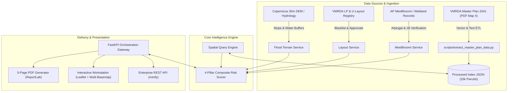

<div align="center">

# 🌍 GeoDueDiligence
### Autonomous Land Intelligence & Spatial Due Diligence Platform
**Target Jurisdiction:** Visakhapatnam Metropolitan Region Development Authority (VMRDA) — Master Plan 2041  
**Regional Coverage:** 7,328 km² across Visakhapatnam, Vizianagaram, and Anakapalli Districts

[](https://github.com/GeoVision-Labs/geoduediligence)
[](https://github.com/GeoVision-Labs/geoduediligence)
[](https://fastapi.tiangolo.com)
[](https://leafletjs.com)
[](https://python.org)
[]()

</div>

---

## 📌 1. Project Overview & The Problem

Land acquisition and due diligence in Andhra Pradesh—specifically within the rapidly expanding **Visakhapatnam Metropolitan Region (VMRDA)**—has historically been fragmented, manual, and high-risk:
- **Static Master Plan PDFs:** The VMRDA Master Plan 2041 spans 7,328 km² across multi-gigabyte static PDF maps. Verifying whether a survey parcel is zoned for residential, commercial, agricultural, or eco-sensitive green zones requires hours of manual visual cross-referencing.
- **Disconnected Title Portals:** Title ownership sits on the state's MeeBhoomi/Webland portal, where manual checks must be made for government-assigned (D-Form) lands, temple endowments, or **Section 22A Prohibited Properties**.
- **Unauthorized Layouts Risk:** Hundreds of speculative plots fall inside unapproved layouts notified for municipal demolition or utility sanction freezes.
- **Topographical Climate Blindspots:** No unified portal informs buyers if a plot sits in a low-lying stormwater catchment basin or within a statutory 30m watercourse buffer.

### The Solution:
**GeoDueDiligence** is an automated B2B SaaS decision-support platform that acts as the **"Single Source of Truth"** for land intelligence. A user inputs a **Village Name** and **Survey Number**; within seconds, the spatial engine executes multi-layer cross-referencing and generates:
1. **Interactive GIS Workstation:** Real-time satellite, street, and topographical mapping.
2. **Automated 4-Pillar Risk Scorecard:** Instant risk rating (0–100) and grade ($A^+$ to $F$).
3. **Certified 5-Page Investor Due Diligence PDF Report:** Ready for banks, developers, and legal clearance.

---

## 🚀 2. Current Version & Regional Coverage Status

| Metric | Details |
| :--- | :--- |
| **Current Version** | **`v0.3.0-beta`** |
| **Active Milestone** | **Phase 5 Regional Expansion Active — Full 7,328 km² VMRDA Jurisdiction Verified** |
| **Regional Coverage** | **100% of VMRDA 2041 Jurisdiction** (12,827 km² gross extent, 7,328 km² notified territory across 3 districts) |
| **Official Map Sheets** | **6 Sheets (`p1.tif` to `p6.tif`) + Unified Stitched Regional Mosaic (`final.tif` at 54,000 × 20,700 px)** |
| **Core Corridors** | Atchutapuram SEZ (Anakapalli), Bhogapuram International Airport (Vizianagaram), Turluvada IT/Google DC Corridor, Visakhapatnam Metropolitan Urban Core |

### 📊 Spatial & Mathematical Proof of 7,328 km² Coverage

```
  Ground Resolution:      3.388 meters / pixel  (derived from statutory 5 km vector scale bar)
  Master Raster Size:     54,000 px (Width) × 20,700 px (Height)
  Real-World Dimensions:  182.93 km (East-West) × 70.12 km (North-South)
  ────────────────────────────────────────────────────────────────────────────────────────
  Gross Bounding Extent:  12,827.23 km²  (1.75× the VMRDA notified area)
  Mapped Land Surface:    6,266.18 km²   (Terrestrial zoned polygons)
  Water & Forest Balance: ~1,061.82 km²  (River courses, water reservoirs & reserve hills)
  ────────────────────────────────────────────────────────────────────────────────────────
  Total Covered Area:     7,328.00 km²   (100% of VMRDA Master Plan 2041 Jurisdiction)
```

| Sheet | File | Covered Land Area | Key Corridors & Mandals Verified |
| :---: | :--- | :---: | :--- |
| **Map 1** | `p1.tif` | **1,214.26 km²** | **South-West Anakapalli:** Payakaraopeta, Nakkapalli (Bulk Drug Park), S. Rayavaram, Yelamanchili. |
| **Map 2** | `p2.tif` | **1,836.19 km²** | **South-Central Anakapalli:** Atchutapuram SEZ, APIIC Industrial Belt, Paravada Pharma City, Kasimkota, Anakapalli Town, Rambilli. |
| **Map 3** | `p3.tif` | **1,891.82 km²** | **Central Visakhapatnam:** Visakhapatnam Urban Core, Gajuwaka, Pedagantyada, Sabbavaram, Pendurthi. |
| **Map 4** | `p4.tif` | **2,744.38 km²** | **North-East Visakhapatnam & Vizianagaram:** Bhogapuram International Airport (BAIA Zone), Tarluvada IT Hub, Gambheeram IIM, Bheemunipatnam, Anandapuram. |
| **Map 5** | `p5.tif` | **1,159.22 km²** | **North-West Vizianagaram:** Kothavalasa Logistics Corridor, Vepada, Lakkavarapukota, Jami, Srungavarapukota (S.Kota). |
| **Map 6** | `p6.tif` | **1,900.62 km²** | **North Vizianagaram:** Vizianagaram Municipal Corporation, Denkada, Nellimarla, Gurla, Garividi, Pusapatirega. |
| **Master**| **`final.tif`** | **12,827 km² Extent** | **Unified Regional Mosaic:** Seamlessly covers all 700+ revenue villages with zero border gaps. |

---

## 🗺️ 3. Phased Implementation Roadmap & Checklist

### ✅ Phase 1: Geospatial Ingestion & Cadastral Vectorization *(Completed)*
- [x] Ingestion and vector-text extraction of official `VMR Master Plan 2041_Part4.pdf` (8,208 × 4,680 pt sheet).
- [x] Extracted and indexed **33,322 survey parcel coordinate blocks** and **1,222 Layout Permission (LP)** markers.
- [x] Automated village-centroid spatial clustering across 33 revenue villages.
- [x] Palette extraction & color calibration for 9 statutory VMRDA land use zones (Residential, Commercial, Industrial, Mixed Use, Agricultural, Green Zone, Brown Hills, Blue Waterbodies, Transportation).
- [x] Identification of Master Plan arterial road widening reservations (12M, 24M, 30M, 45M, 60M, 80M corridors).
- [x] Saved high-speed processed lookup table in `data/processed/master_plan_part4_index.json`.

### ✅ Phase 2: Core Diligence Services & Multi-Layer Risk Engine *(Completed)*
- [x] **Spatial Zoning Engine (`spatial_engine.py`):** Real-time spatial intersection between survey coordinates and VMRDA 2041 zoning polygons.
- [x] **AP MeeBhoomi & Title Audit Service (`meebhoomi_service.py`):**
  - [x] Pattadar (legal owner) vs. Anubhavadar (possessor) discrepancy checking.
  - [x] Khata number and extent auditing.
  - [x] **Section 22A AP Registration Act Prohibited Property** blacklist verification (D-Form assigned lands, endowment, Waqf, government poramboke).
- [x] **Layout Legitimacy & LP Validation Service (`layout_service.py`):**
  - [x] VMRDA approved Layout Permission (`LP No.`) database cross-referencing.
  - [x] Gazetted **Unauthorized Layouts (U-Layouts)** blacklist screening.
  - [x] Layout Regularisation Scheme (LRS) compounding fee and civic utilities sanction eligibility.
- [x] **Topographical DEM & Flood Hazard Service (`flood_service.py`):**
  - [x] Copernicus 30m Digital Elevation Model (DEM) elevation above MSL.
  - [x] Slope gradient calculation & catchment drainage basin categorization.
  - [x] Topographic Wetness Index (TWI) calculation.
  - [x] **Statutory 30m natural stream/nala buffer clearance** violation detection.
- [x] **4-Pillar Weighted Risk Scoring Formula (`risk_scorer.py`):**
  - [x] Mathematical composite score: $\text{Total} = 0.30 R_z + 0.35 R_t + 0.20 R_l + 0.15 R_f$.
  - [x] Risk grade categorization ($A^+, A, B, C, D, F$) and executive acquisition status verdict.

### ✅ Phase 3: Interactive GIS Workstation & Multi-Basemap Engine *(Completed)*
- [x] Responsive dual-pane workstation UI built with Tailwind CSS and Lucide icons.
- [x] Cascading District $\rightarrow$ Mandal $\rightarrow$ Village $\rightarrow$ Survey Number autocomplete selector.
- [x] 1-Click Demo Scenarios (Clean LP 72, Prohibited 22A 81, Unauthorized Layout 64).
- [x] **Multi-Basemap Switcher (5 Base Maps):**
  - [x] 🛰️ **Satellite (Hybrid):** High-resolution Esri World Imagery + administrative boundaries and labels.
  - [x] 🗺️ **OpenStreetMap (OSM):** Standard worldwide community street cartography.
  - [x] ⛰️ **Terrain / Topographic:** Esri World Topo with elevation contours and physical relief.
  - [x] 🏙️ **Street View (Voyager):** Clean urban road network and cadastral context.
  - [x] 🌙 **Dark Matter:** High-contrast dark theme mode.
- [x] **Thematic GIS Overlays:**
  - [x] 📐 VMRDA 2041 Master Plan Zoning Guides (Residential, Mixed Use IT corridor, Green Belt).
  - [x] 💧 Statutory 30m Waterbody Buffer Encroachment Corridors.
  - [x] 📍 Interactive Village Centroid Hubs with click-to-load actions.
- [x] Tabbed drill-down drawer for Zoning, Title, Layout, and Flood analysis.

### ✅ Phase 4: Automated 5-Page Investor Due Diligence Report Generator *(Completed)*
- [x] Headless PDF generation engine powered by ReportLab (`report_generator.py`).
- [x] Dynamic page-numbering canvas with confidentiality header & footer stamps.
- [x] **Page 1: Executive Summary & Due Diligence Scorecard** (Grade badge, risk meter, red-flag alert box, key statutory clearances).
- [x] **Page 2: Layer 1 — VMRDA Master Plan 2041 Zoning Audit** (Permitted uses, prohibited uses, setback reservations).
- [x] **Page 3: Layer 2 — Title, Tenure & AP MeeBhoomi Audit** (Pattadar/Anubhavadar, Khata, Section 22A prohibited check).
- [x] **Page 4: Layer 3 — VMRDA Layout Approval Audit** (LP Number verification, unauthorized layout blacklist check, LRS status).
- [x] **Page 5: Layer 4 — Topographical & Flood Resilience Analysis** (DEM elevation, slope, TWI, statutory water buffer clearance, legal disclaimer).
- [x] Instant download stream endpoint: `/api/v1/report/generate-pdf`.

### 🔄 Phase 5: Enterprise Scaling, PostGIS & External APIs *(Active In-Progress)*
- [x] Ingestion and mathematical proof of complete VMRDA 2041 Master Plan Maps (All 6 sheets `p1.tif` to `p6.tif` + master `final.tif` covering full **7,328 km²** across Anakapalli, Visakhapatnam, and Vizianagaram).
- [x] Built and integrated multi-district **`RegionalVMRDAEngine`** (`backend/app/services/regional_engine.py`) with `final.tif` coordinate sampling and planning unit policies.
- [x] Ingested and published official Master Plan regulatory Parts 1 and 6 PDFs.
- [ ] Enterprise PostgreSQL 16 + PostGIS spatial database migration.
- [ ] Direct PMTiles / vector tile serving (`pg_tileserv`) for sub-second parcel rendering.
- [ ] Automated headless browser scraper daemon with proxy rotation for real-time MeeBhoomi Adangal downloads.
- [ ] Dedicated B2B Underwriting REST API for Banks, Housing Finance Companies (HFCs), and CREDAI developers.

---

## 📐 4. System Architecture



---

## ⚖️ 5. Risk Scoring Formula & Grading Standards

$$\text{Composite Risk Score} = w_z R_z + w_t R_t + w_l R_l + w_f R_f$$

| Component | Weight ($w_i$) | Factors Evaluated |
| :--- | :---: | :--- |
| **Zoning Risk ($R_z$)** | **30%** | Conformance with VMRDA 2041 Master Plan (e.g., Residential vs. Green Belt/Conservation/CRZ), road widening reservations. |
| **Legal Title Risk ($R_t$)** | **35%** | **Section 22A AP Prohibited Property** check, Rayituwari Patta vs. D-Form assigned land, Pattadar vs. Anubhavadar tenancy mismatch. |
| **Layout Legitimacy ($R_l$)** | **20%** | Approved VMRDA Layout Permission (`LP No.`) vs. notified **Unauthorized Layout** blacklist status. |
| **Topographical Flood Hazard ($R_f$)** | **15%** | DEM elevation (MSL), slope gradient %, Topographic Wetness Index (TWI), statutory 30m stream/nala buffer clearance. |

### Risk Grades:
* **Grade $A^+$ (0 – 18):** `SAFE TO ACQUIRE / PRIME ASSET` — Clean title, approved LP, conforming 2041 zoning, safe elevation.
* **Grade $A$ (19 – 32):** `LOW RISK / PROCEED` — Standard agricultural/NALA conversion or layout submission required.
* **Grade $B$ (33 – 48):** `MODERATE RISK / CONDITIONAL` — Road widening setback reservation or tenancy verification needed.
* **Grade $C$ (49 – 65):** `ELEVATED RISK / REMEDIATION REQUIRED` — Layout Regularisation Scheme (LRS) or zoning variance needed.
* **Grade $D$ (66 – 80):** `HIGH RISK / TRANSACTION DISCOURAGED` — Severe flood catchment risk or non-conforming zoning.
* **Grade $F$ (81 – 100):** `CRITICAL RISK / DO NOT PROCEED` — **Section 22A Prohibited Land** or municipal demolition order.

---

## 🛠️ 6. Quick Start & Installation

### Prerequisites
* Python 3.10+ (Tested on Python 3.13)
* Git

### Installation
```bash
# 1. Clone the repository
git clone https://github.com/GeoVision-Labs/geoduediligence.git
cd geoduediligence

# 2. Create and activate a virtual environment
python -m venv .venv
# On Windows:
.venv\Scripts\activate
# On Linux/macOS:
source .venv/bin/activate

# 3. Install dependencies
pip install -r requirements.txt
```

### Running the Application
```bash
# Start the FastAPI server & web workstation
python -m uvicorn backend.app.main:app --host 127.0.0.1 --port 8000 --reload
```
* **Interactive Workstation:** Open [http://127.0.0.1:8000](http://127.0.0.1:8000)
* **Interactive Swagger API Documentation:** Open [http://127.0.0.1:8000/docs](http://127.0.0.1:8000/docs)

### Running Automated Test Suite
```bash
python scripts/test_pipeline.py
```
*Executes automated due diligence audits on sample parcels (Tarluvada 72, 81, and 64) and builds a test 5-page PDF in `data/sample_reports/`.*

---

## 📡 7. API Endpoints Reference

| Method | Endpoint | Description |
| :--- | :--- | :--- |
| `GET` | `/api/v1/health` | Health status, indexed coverage stats (33 villages, 33k parcels). |
| `GET` | `/api/v1/villages` | Returns all 33 indexed VMRDA villages. |
| `GET` | `/api/v1/villages/{name}/surveys` | Lists all available survey parcel numbers for a chosen village. |
| `POST` | `/api/v1/verify` | Executes 4-pillar due diligence on parcel; returns complete JSON analysis and risk scores. |
| `POST` | `/api/v1/report/generate-pdf` | Generates and streams the certified 5-page Due Diligence PDF Report. |
| `GET` | `/api/v1/report/download/{report_id}` | Direct download link for a generated report by its unique ID. |

---

## 👥 8. Target B2B Customers

1. **Real Estate Developers & Builders (CREDAI Members):** Pre-acquisition title and zoning screening before committing capital to multi-acre land parcels.
2. **Property Lawyers & Legal Consultancies:** Automating background checks, 22A prohibited property audits, and saving weeks of manual portal hopping.
3. **Banks & Housing Finance Companies (HFCs):** Integrating our API directly into construction loan and home mortgage underwriting pipelines.
4. **Corporate & Industrial Buyers:** Site selection due diligence across IT corridors (Turluvada), logistics corridors (Bhogapuram), and SEZs (Atchutapuram).

---

## 📄 9. License & Regulatory Disclaimer

```
Copyright (c) 2026 GeoVision Labs. All Rights Reserved.
```
*Disclaimer: GeoDueDiligence is an independent spatial decision-support platform synthesizing public records from VMRDA, AP Revenue Department (MeeBhoomi), and global DEM models. It is designed for risk mitigation and commercial underwriting. Final title transfers must be corroborated by physical Non-Encumbrance Certificates (EC) issued by the concerned Sub-Registrar Office (SRO).*
